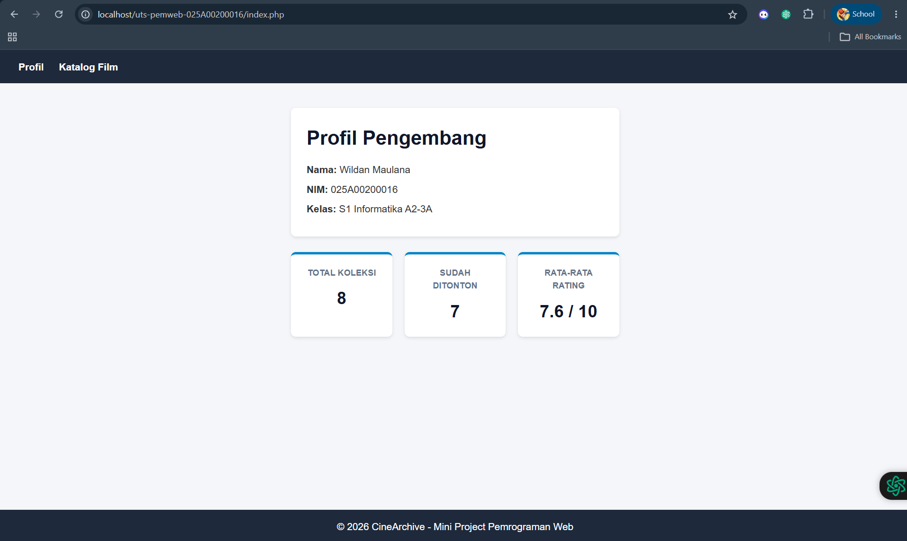
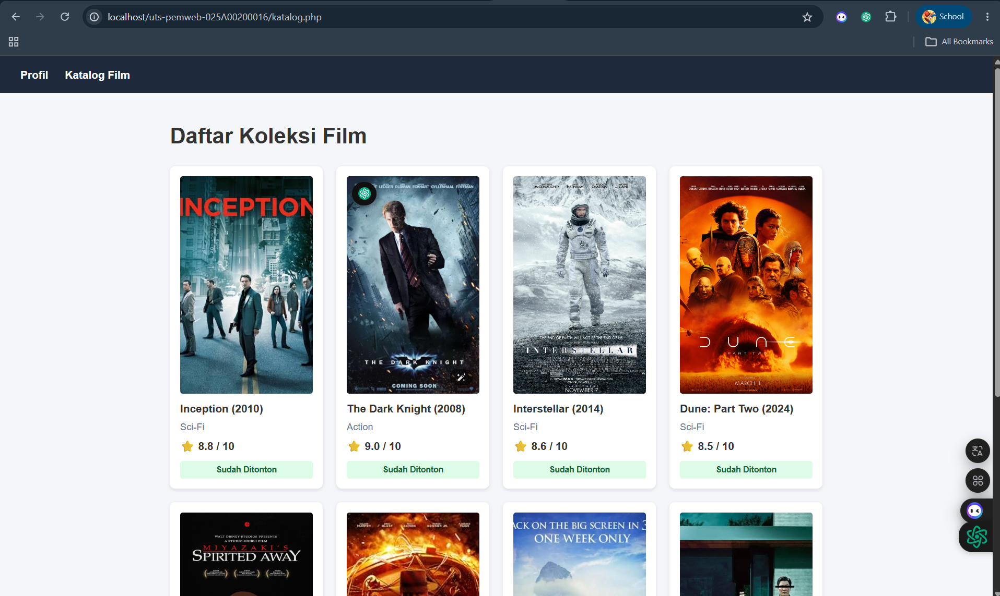

# UTS Pemrograman Web - CineArchive

## 1. Identitas
- **Nama:** Wildan Maulana
- **NIM:** 025A00200016
- **Kelas:** S1 Informatika A2-3B

## 2. Deskripsi Proyek
CineArchive adalah aplikasi katalog berbasis web sederhana menggunakan PHP Native tanpa database. Aplikasi ini digunakan untuk mencatat dan mengelola daftar koleksi film pribadi, status penontonan, serta menampilkan statistik ringkasan rating koleksi secara dinamis.

## 3. Cara Menjalankan di Localhost
1. Unduh atau clone repositori ini ke direktori web server local (`htdocs` untuk XAMPP atau `www` untuk Laragon).
2. Buka XAMPP/Laragon dan jalankan service Apache.
3. Akses aplikasi melalui browser di alamat: `http://localhost/uts-pemweb-025A00200016/index.php`.

## 4. Daftar Fitur
- **Halaman Profil Pengembang (`index.php`)**: Menampilkan data diri pengembang serta ringkasan statistik koleksi.
- **Halaman Katalog Film (`katalog.php`)**: Menampilkan daftar seluruh film beserta poster, genre, tahun, rating, dan status penontonan menggunakan perulangan `foreach`.
- **Sanitasi Data XSS (`functions.php`)**: Menggunakan fungsi buatan `e()` untuk mengamankan cetakan output HTML.
- **Perhitungan Rata-rata Rating (`functions.php`)**: Menggunakan fungsi buatan `getAverageRating()` untuk mengkalkulasi nilai rata-rata rating film.

## 5. Daftar Fungsi Array Bawaan
- `count()`: Menghitung total koleksi film dan total film yang sudah ditonton.
- `array_filter()`: Menyaring film berdasarkan status (`Watched`).
- `array_column()`: Mengambil seluruh nilai kolom `rating` dari array multidimensi film.
- `array_sum()`: Menjumlahkan seluruh rating film untuk kalkulasi rata-rata rating.

## 6. Tangkapan Layar (Screenshots)

## 7. Sumber Referensi & Catatan Pemakaian AI
- **Referensi:** 
  - Dokumentasi Resmi PHP (php.net) untuk penanganan `declare(strict_types=1);` dan array functions.
  - MDN Web Docs untuk dokumentasi Flexbox CSS dan `object-fit: cover`.
- **Penggunaan AI:**
  - AI (Gemini) digunakan untuk membantu penataan tata letak CSS (*Flexbox centering & uniform poster sizing*), konsultasi error PHP syntax, serta penyesuaian struktur file sesuai standar PSR-12. Setiap baris kode yang dihasilkan telah diperiksa dan diuji ulang secara mandiri.